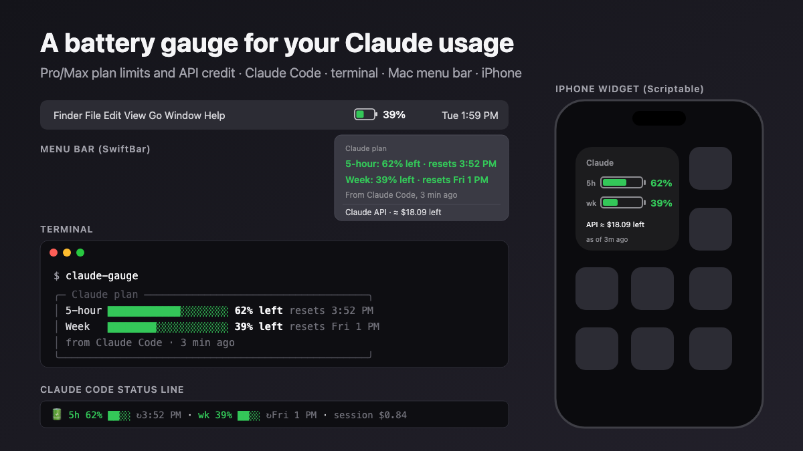

# Claude Usage Gauge

**A battery icon for your Claude usage.** See how much of your Claude Pro/Max plan is left this session and this week, and, if you also pay for the API, how much credit is left. In Claude Code's status line, your terminal, the Mac menu bar and your iPhone home screen.



*(Sample numbers.)*

Two gauges, use either or both:

| | **Claude Pro / Max plan** | **Claude API credit** |
|---|---|---|
| Shows | 5-hour and weekly limits: % left, when each resets | ≈ credit left, today, this month, $/day, days of runway |
| Comes from | Claude Code, which passes your plan usage to its status line | Anthropic's Cost API |
| Needs | Claude Code | An Admin API key from a Console organization |
| Setup | 2 minutes | 10 minutes |

- **One small script.** Node 18+, no dependencies, no server, no database.
- **Nothing leaves your machine** except to Anthropic. Keys stay in the macOS Keychain; the phone widget only sees the summary.
- **Honest about what it knows.** Plan usage is as of your last Claude Code reply. API credit is an **estimate**, because Anthropic's API reports spend but not your balance. [Details](docs/GUIDE.md#what-it-can-and-cant-know).

## Quick start: Claude Pro / Max

```bash
git clone https://github.com/JESeltz/claude-usage-gauge.git
cd claude-usage-gauge
npm link                  # puts `claude-gauge` on your PATH
```

Add to `~/.claude/settings.json`:

```json
{ "statusLine": { "type": "command", "command": "claude-gauge line" } }
```

Start Claude Code and send a message. Under the prompt:

```
🔋 5h 75% ███░ ↻4:50 PM · wk 81% ███░ ↻Sat 1 PM · session $0.84
```

Run `claude-gauge` in any terminal for the full card. [Menu bar](docs/GUIDE.md#part-5--the-mac-menu-bar) and [iPhone widget](docs/GUIDE.md#part-6--iphone-home-screen-widget) take a few minutes more.

## What the numbers mean

**Claude Pro / Max** (from Claude Code):

| You see | It means |
|---|---|
| `5h 75%` | You have **75% left** of your plan's 5-hour usage limit (25% used). |
| `↻4:50 PM` | That 5-hour window resets at 4:50 PM, back to 100%. |
| `wk 81%` | You have **81% left** of your weekly limit. |
| `↻Sat 1 PM` | The weekly limit resets Saturday at 1 PM. |
| Menu bar `Claude 75%` | The **lower** of the two, because that's the one that will stop you first. |
| `session $0.84` | Claude Code's estimate of what this session would cost at API prices. On a plan you don't pay it; it shows how heavy the session is. |

The percentages are shares of your plan's limits, not token counts. Bigger models and longer sessions use them faster. When one reaches 0%, Claude limits you until the window resets.

**API credit** (from Anthropic's Cost API):

| You see | It means |
|---|---|
| `≈ $27.24 left` / `100%` | The balance you entered, minus spend since; the % is how much of that balance is left. |
| `~$10.99/day` | Average spend over the last 7 full days. |
| `about 2 days at this pace` | Credit left ÷ that average. |

Colors: green, then amber at 25% left, red at 10%.

## Add API credit (optional)

```bash
claude-gauge setup        # store an Admin API key and your current balance
```

[Step-by-step](docs/GUIDE.md#part-1--api-credit-the-anthropic-side), including how to get the key.

## Commands

| Command | What it does |
|---|---|
| `claude-gauge` | The card(s): plan windows and/or API credit |
| `claude-gauge line` | One line, for Claude Code's status line (reads your plan usage from it) |
| `claude-gauge swiftbar` | Menu-bar plugin output |
| `claude-gauge json` | Everything as JSON |
| `claude-gauge setup` | API credit: store your key and balance |
| `claude-gauge balance 42.50` | API credit: re-enter the balance shown in the Console |
| `claude-gauge topup 25` | API credit: you added credit |
| `claude-gauge budget 100` | API spend against a monthly budget instead (`budget off` to clear) |

Flags: `--refresh` (skip the 5-minute cache), `--demo`, `--no-color`.

## Limits, plainly

- **Plan usage comes only from Claude Code.** Anthropic doesn't publish Pro/Max limits through any API. Claude Code passes them to its status line after each reply, so the card, menu bar and phone show the latest reading and how old it is. A window that has reset since then shows as reset.
- **API credit is an estimate:** the balance you enter, minus spend since. It drifts if credit changes without you telling it (auto-reload, promotions, refunds); re-enter it with `claude-gauge balance`.
- **API data is somewhat behind real time** (minutes to a few hours); the card shows what time it runs through.
- **The API gauge needs a Console organization** (free to set up); Anthropic's Admin API isn't available to individual accounts.

## Security

The Pro/Max gauge needs no key at all. For the API gauge: an Admin API key can manage your whole Anthropic organization, not just read costs. `claude-gauge setup` stores it in the Keychain; give it an expiration date, never commit it, and delete it in the Console if a laptop goes missing. The gauge only ever *reads* cost data.

## License

MIT
