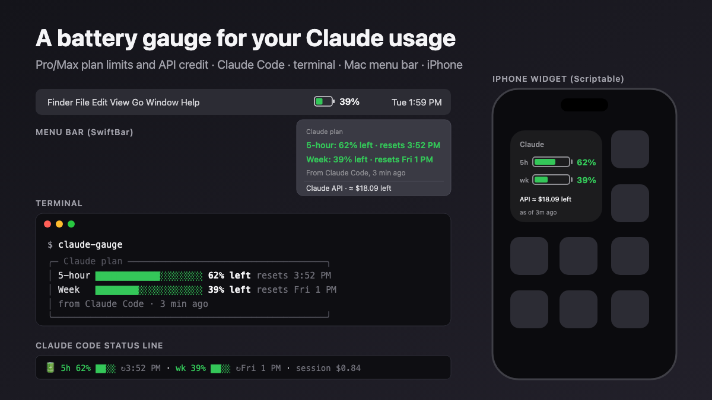

# The complete guide

From nothing to a battery gauge for your Claude usage, in Claude Code, your terminal, the Mac menu bar and your iPhone. Every step says what you should see when it worked.



**Two gauges, use either or both:**

- **Claude Pro / Max plan:** how much of your 5-hour and weekly limits is left. Needs only Claude Code. **Start at [Part 0](#part-0--claude-pro--max-in-two-minutes)**: two minutes, no key.
- **Claude API credit:** how much prepaid credit is left, for people who also pay for the API. Needs an Admin API key. Parts 1–3.

**Contents**

- [What it can and can't know](#what-it-can-and-cant-know)
- [Part 0 · Claude Pro / Max in two minutes](#part-0--claude-pro--max-in-two-minutes)
- [Part 1 · API credit: the Anthropic side](#part-1--api-credit-the-anthropic-side)
- [Part 2 · Getting the code from GitHub](#part-2--getting-the-code-from-github)
- [Part 3 · The terminal](#part-3--the-terminal)
- [Part 4 · Claude Code's status line](#part-4--claude-codes-status-line)
- [Part 5 · The Mac menu bar](#part-5--the-mac-menu-bar)
- [Part 6 · iPhone home-screen widget](#part-6--iphone-home-screen-widget)
- [How the estimate works](#how-the-estimate-works)
- [Troubleshooting](#troubleshooting)
- [Publishing your own copy on GitHub](#publishing-your-own-copy-on-github)
- [Uninstall](#uninstall)

---

## What it can and can't know

**Claude Pro / Max plan.** Anthropic doesn't publish plan limits through any API. Claude Code does show them to one place: the **status line**, a script Claude Code runs to draw a line under your prompt. With each reply it passes the script your 5-hour and weekly usage (percent used, and when each window resets). The gauge reads that, shows it, and saves it, so the terminal card, menu bar and phone can show the latest reading too. They always say how old it is ("as of 12 min ago"), and a window that has reset since then shows as reset. If you haven't used Claude Code for a while, the reading is from then.

**Claude API credit.** Anthropic gives organizations an **Admin API** whose **Cost API** reports exactly what your organization has spent, by day and by hour. That part is precise. It runs somewhat behind real time (about 30 minutes in testing; Anthropic says up to a few hours), and the gauge shows what time its data runs through. What Anthropic does **not** offer is an endpoint for your **remaining prepaid credit**. So the gauge works it out:

> **credit left ≈ the balance you type in − what the Cost API says you've spent since**

That's the same thing you'd do with a checkbook. It's accurate as long as the only thing changing your balance is usage. When you add credit, tell it (`claude-gauge topup 25`), or re-enter the Console's number at any time (`claude-gauge balance 42.50`). Everything labelled "≈" or "estimate" is this calculation. Paying by monthly invoice instead of credit? Use `budget` mode.

**What you need:**

| | |
|---|---|
| Node.js 18 or newer | Part 0 / Part 3 |
| Claude Code (for the Pro/Max gauge) | Part 0 |
| An Anthropic Console **organization** where you're an **admin** (API gauge only) | Part 1 |
| A Mac for the Keychain, menu bar and iPhone widget. The terminal and Claude Code parts also work on Linux and Windows | |
| Optional: SwiftBar (menu bar), Scriptable on iPhone (widget) | Parts 5–6 |

---

## Part 0 · Claude Pro / Max in two minutes

1. **Get the code and install the command** (details in [Part 2](#part-2--getting-the-code-from-github) and [Part 3.1](#31-check-nodejs)):

   ```bash
   cd ~/Documents
   git clone https://github.com/JESeltz/claude-usage-gauge.git
   cd claude-usage-gauge
   npm link
   ```

   ✅ `claude-gauge --demo` prints two sample cards.

2. **Turn on the status line.** Open `~/.claude/settings.json` (create it if it doesn't exist) and add the `statusLine` block. If the file already has settings, put it inside the existing `{ }` with a comma after the previous entry:

   ```json
   {
     "statusLine": {
       "type": "command",
       "command": "claude-gauge line"
     }
   }
   ```

3. **Start Claude Code and send any message.** Plan usage arrives with Claude's first reply.

   ✅ Under the prompt: `🔋 5h 62% ██░░ ↻3:52 PM · wk 39% ██░░ ↻Fri 1 PM · session $0.84`

   - **5h 62%:** you have 62% **left** of your plan's 5-hour usage limit. **↻3:52 PM** is when that window resets to 100%.
   - **wk 39%:** you have 39% left of your weekly limit, which resets at the time after its ↻.
   - These are shares of your plan's limits, not token counts. Bigger models and longer sessions use them faster. When one reaches 0%, Claude limits you until that window resets, so the lower number is the one to watch. (The menu bar shows the lower one.)
   - **session:** Claude Code's own estimate of this session's cost at API list prices. On a plan you don't pay it; it shows how heavy a session is.
   - The battery turns 🪫 and the numbers go amber at 25% left and red at 10%.

4. **Anywhere else:** run `claude-gauge` in a terminal for the card. For the menu bar and phone, see [Part 5](#part-5--the-mac-menu-bar) and [Part 6](#part-6--iphone-home-screen-widget).

That's it for Pro/Max. Parts 1–3 add the API credit gauge, if you use the API.

---

## Part 1 · API credit: the Anthropic side

### 1.1 Make sure you have an organization

The Admin API isn't available to individual accounts.

1. Go to **[platform.claude.com/settings/organization](https://platform.claude.com/settings/organization)**.
2. If you're on an individual account, follow the prompt there to set up an organization (it's free).
3. Check your role is **admin**. Only admins can create Admin API keys.

### 1.2 Create an Admin API key

1. Go to **[platform.claude.com/settings/admin-keys](https://platform.claude.com/settings/admin-keys)**.
2. Click **Create admin key**.
3. **Name:** `claude-gauge` (so you know later what it's for).
4. **Expiration:** pick one, e.g. 90 days. You'll make a new key when it expires, which limits the damage if one leaks.
5. Click **Add**.
6. **Copy the key now.** It starts with `sk-ant-admin01-` and is shown **only once**. Keep it on your clipboard for Part 3; don't paste it into a document or chat.

> **Why "admin"?** Cost data sits behind Anthropic's Admin API, and Console admin keys can't be limited to read-only. This one key could also manage members and other keys, so treat it like a password. The gauge only ever calls the two cost-reading endpoints, and setup stores the key in your Mac's Keychain, not in a file.

### 1.3 Find your current credit balance

1. Go to **[platform.claude.com/settings/billing](https://platform.claude.com/settings/billing)**.
2. Note the **credit balance**, e.g. `$42.50`. You'll type it into setup.

### 1.4 Strongly recommended: turn on auto-reload

On the same billing page, turn on **auto-reload** so your credit can't hit zero mid-job. The gauge tells you when you're running low; auto-reload makes sure you never run out. If you use auto-reload, run `claude-gauge topup <amount>` when it fires (you'll get an email), or re-enter the balance now and then.

---

## Part 2 · Getting the code from GitHub

You need the files on your computer. Pick one:

**A. With git** (in Terminal):

```bash
cd ~/Documents
git clone https://github.com/JESeltz/claude-usage-gauge.git
cd claude-usage-gauge
```

✅ You should see a new `claude-usage-gauge` folder with `bin`, `src`, `widgets` and `docs` inside.

**B. Without git:** open the repository on GitHub, click the green **Code** button, choose **Download ZIP**, unzip it into `Documents`, and in Terminal run `cd ~/Documents/claude-usage-gauge-main`.

To get updates later: `git pull` inside the folder (A), or download the ZIP again (B).

---

## Part 3 · The terminal

### 3.1 Check Node.js

```bash
node -v
```

✅ You see `v18…` or higher. If you see "command not found", install Node: `brew install node` with [Homebrew](https://brew.sh), or the installer from [nodejs.org](https://nodejs.org).

### 3.2 Install the command

Inside the `claude-usage-gauge` folder:

```bash
npm link
```

This puts `claude-gauge` on your PATH, so it works from any folder. (If it complains about permissions, your Node install needs `sudo npm link`, or use Homebrew's Node, which doesn't.)

### 3.3 Try it with sample data

```bash
claude-gauge --demo
```

✅ Two sample cards: **Claude plan** (5-hour and weekly bars) and **Claude API** (a battery, "≈ $18.09 left", today's spend and a daily burn rate). No key is needed for the demo.

### 3.4 Set it up for real

```bash
claude-gauge setup
```

1. Press **Enter**, then paste your Admin API key **twice** when macOS asks (the characters stay hidden). It goes into the Keychain under "claude-usage-gauge".
   *On Linux or Windows, add `export CLAUDE_GAUGE_ADMIN_KEY=sk-ant-admin01-…` to your shell profile instead, open a new terminal, and run setup again.*
2. Setup checks the key with Anthropic. ✅ `Checking the key with Anthropic... ok (analytics).`
3. Type your credit balance from step 1.3, e.g. `42.50`.
   *No prepaid credit (invoiced billing)? Press Enter, then enter a monthly budget to track spend against instead.*

### 3.5 Use it

```bash
claude-gauge
```

✅ Your real numbers: battery, ≈ credit left, today, this month, average daily spend over the last week, and roughly how many days that leaves. If you've also set up the status line (Part 0), the **Claude plan** card appears above it.

| When | Run |
|---|---|
| You added credit | `claude-gauge topup 25` |
| You want to re-sync with the Console's number | `claude-gauge balance 42.50` |
| You want fresh numbers right now (skip the 5-minute cache) | `claude-gauge --refresh` |
| You'd rather track a monthly budget | `claude-gauge budget 100` (`budget off` to clear) |

**Colors:** green above 25% left, amber at 25% or below, red at 10% or below. To change the thresholds, edit `warn_pct` and `critical_pct` in `~/.config/claude-usage-gauge/config.json`.

---

## Part 4 · Claude Code's status line

Claude Code can show any command's output in a line under the prompt. The gauge's `line` mode is made for it, and it's also how the gauge gets your Pro/Max plan usage. (Already did Part 0? This is the same step; skip to the notes below.)

1. Open `~/.claude/settings.json` (create it if it doesn't exist).
2. Add:

   ```json
   {
     "statusLine": {
       "type": "command",
       "command": "claude-gauge line"
     }
   }
   ```

   If the file already has settings, add the `"statusLine"` block inside the existing `{ }`, with a comma after the previous entry.
3. Start a new Claude Code session.

✅ Under the prompt, depending on what you use:

| You have | The line |
|---|---|
| Pro / Max | `🔋 5h 62% ██░░ ↻3:52 PM · wk 39% ██░░ ↻Fri 1 PM · session $0.84` |
| API credit | `🔋 36% █░░░ · ≈$18.09 left · today $3.41 · session $0.84` |
| Both | `🔋 5h 62% ██░░ ↻3:52 PM · wk 39% ██░░ ↻Fri 1 PM · API ≈$18.09 · session $0.84` |

- **session $0.84** is Claude Code's own estimate for the current session at API list prices. The rest is the gauge.
- Plan usage arrives with Claude's first reply in a session, and updates with each one.
- The line updates as you work. The API numbers are cached for 5 minutes, so it stays instant and never hammers Anthropic's API.
- The battery turns 🪫 and the numbers go amber at 25% left and red at 10%.
- If the API key is missing or rejected, the line says so instead of going blank.

---

## Part 5 · The Mac menu bar

[SwiftBar](https://swiftbar.app) is a free, open-source app that puts a script's output in the menu bar.

1. Install it: `brew install --cask swiftbar`, or download it from [swiftbar.app](https://swiftbar.app).
2. Create a plugins folder: `mkdir ~/SwiftBar`. Then open SwiftBar; it asks you to choose a **plugins folder**: pick `SwiftBar` in your home folder (⇧⌘H jumps there).
3. Copy the plugin in and make it runnable:

   ```bash
   cp ~/Documents/claude-usage-gauge/widgets/claude-gauge.5m.sh ~/SwiftBar/
   chmod +x ~/SwiftBar/claude-gauge.5m.sh
   ```

4. Click SwiftBar's menu and choose **Refresh All**.

✅ A battery icon with a percentage appears in the menu bar: your plan's tighter window (5-hour or weekly, whichever has less left), or your API credit if you don't have a plan reading. Click it for both windows and when they reset, the API details, links to your Claude usage settings and Anthropic billing, and **Refresh**.

- The `5m` in the file name means it refreshes every 5 minutes. Rename it `claude-gauge.15m.sh` to refresh less often.
- The icon is green, amber or red, like the terminal.
- It reads **Claude 75%**. To change the word, set `"menu_label"` in `~/.config/claude-usage-gauge/config.json` (e.g. `"Max"`, or `""` for just the number).
- If you see ⚠︎: click it to read the message. Usually `npm link` wasn't run. Menu-bar apps don't load your shell profile, so the plugin looks for Node in Homebrew, Volta, fnm and nvm's usual places; if yours is elsewhere, add its folder to the `PATH` line at the top of the plugin.

---

## Part 6 · iPhone home-screen widget

The widget reads a small summary file that the gauge on your Mac writes to iCloud Drive. **No key goes on the phone.** The Mac does the work; the phone just shows the result. It shows your plan's 5-hour and weekly bars, your API credit, or both.

1. On the iPhone, install **[Scriptable](https://apps.apple.com/app/scriptable/id1405459188)** (free) and open it once.
2. In iPhone **Settings → [your name] → iCloud**, make sure **iCloud Drive** is on and **Scriptable** is allowed to use it.
3. On the Mac, open **Finder → iCloud Drive**. ✅ A **Scriptable** folder appears (it can take a minute).
4. On the Mac, run `claude-gauge` once. ✅ `claude-gauge.json` appears in that Scriptable folder. From now on, every run updates it: each Claude Code reply (through the status line), and the menu-bar plugin every 5 minutes.
5. **Put the widget script in that folder, from the Mac** (easiest: no copying code on the phone):

   ```bash
   cp ~/Documents/claude-usage-gauge/widgets/claude-gauge-widget.js \
     ~/Library/Mobile\ Documents/iCloud~dk~simonbs~Scriptable/Documents/"Claude Gauge.js"
   ```

   ✅ Within a minute, **Claude Gauge** appears in Scriptable's list on the phone (pull down to refresh).
   *No Scriptable folder on the Mac yet? On the phone, tap **+** in Scriptable, type anything, tap **Done**: saving a script creates the folder. Or paste the file's contents into a new script by hand: open it on GitHub on your phone, tap **Raw**, select all, copy.*
6. Tap ▶︎ to preview. ✅ A small dark widget with the battery.
7. Go to the home screen, **long-press → Edit → Add Widget → Scriptable**, choose the **small** size, add it, then long-press it → **Edit Widget** → **Script: Claude Gauge**.

✅ The battery on your home screen. Tap it to open your Claude usage settings (or Anthropic billing, for API-only).

- iOS decides how often widgets refresh, usually every 15–30 minutes. The footer shows how old the numbers are if they're more than 30 minutes old.
- The phone is only as fresh as the Mac's last run, and plan usage only as fresh as your last Claude Code reply. The footer says how old the numbers are.
- Works on iPad too. For an Android home-screen version, you'd need a different widget app; the same JSON file works with any of them.

---

## How the estimate works

When you enter your balance, the gauge remembers two things: the **amount** and the **moment**. After that, it asks Anthropic's Cost API for your total spend since that moment:

```
credit left ≈ balance − spend since you entered it
```

**Example.** At 1:24 PM you enter **$27.24**. By evening the Cost API reports $4.10 spent since 1:00 PM: `27.24 − 4.10 = $23.14` left.

The API counts from the start of the hour you entered the balance (1:00 PM above), so a little spend from before you entered it can be counted twice. The estimate errs toward **less** credit, never more.

**Other numbers:**

- **Today / this month:** straight from the Cost API (UTC days, so "today" rolls over at UTC midnight).
- **~$/day:** the average of the last 7 full days.
- **About N days at this pace:** credit left ÷ that average. It's a pace, not a promise: one big batch job changes it.

**When the estimate drifts, and how to fix it:**

| Cause | Fix |
|---|---|
| Auto-reload or a manual top-up | `claude-gauge topup <amount>` |
| Promotional credit, refund, expired credit | `claude-gauge balance <Console balance>` |
| Priority Tier commitments | Not in the Cost API; use the budget mode or the Console |
| Spend since the time shown after "through" | Appears when Anthropic's data catches up |

When in doubt, re-enter the Console's number. That always resets it to exact.

**Where the data comes from:** Anthropic's Usage and Cost Analytics API, `GET /v1/organizations/analytics/cost` (beta). It includes today so far and can total from a given hour. If your organization doesn't have it, the gauge falls back to the older cost report, `GET /v1/organizations/cost_report`, which only has **finished** days: "today" then shows as —, and the estimate counts whole days. The card's last line says which one it's using. Docs: [Analytics API](https://platform.claude.com/docs/en/manage-claude/usage-cost-analytics-api), [cost report](https://platform.claude.com/docs/en/manage-claude/usage-cost-api).

---

## Troubleshooting

| You see | Do this |
|---|---|
| `No Admin API key found` | Run `claude-gauge setup`, or set `CLAUDE_GAUGE_ADMIN_KEY` |
| `Anthropic rejected the key (401)` | It must be an **Admin** key (`sk-ant-admin01-`), not a regular `sk-ant-api03-` key. It may have expired: make a new one (Part 1.2) and run setup again |
| `(403)` | Your Console role isn't admin, or the account isn't an organization (Part 1.1) |
| `OFFLINE, showing last known` | No network or Anthropic was unreachable; it shows the last good numbers until it can refresh |
| Credit left looks wrong | Re-enter the Console balance: `claude-gauge balance 42.50` |
| `command not found: claude-gauge` | Run `npm link` in the folder (Part 3.2), or open a new terminal |
| Menu bar shows ⚠︎ | Click it for the message; usually Part 3.2 wasn't done |
| Widget says "Run claude-gauge on your Mac" | Steps 6.2–6.4: iCloud Drive for Scriptable, then run `claude-gauge` on the Mac |
| Status line is blank | Run `claude-gauge line` in a terminal to see the error; check the JSON in `settings.json` is valid |
| Status line shows no 5h / wk | Plan usage comes with Claude's first reply: send a message. It only appears for Pro, Max and Ultra plans, not when Claude Code uses an API key |
| Status line says `claude-gauge: plan usage appears after…` | Normal before the first reply in a session, if you haven't set up API credit |
| Plan numbers look old | They're from your last Claude Code reply (the card says how long ago). Use Claude Code and they refresh |

Files: settings in `~/.config/claude-usage-gauge/config.json`, API cache in `~/.cache/claude-usage-gauge/daily.json`, last plan reading in `~/.cache/claude-usage-gauge/plan.json`, key in Keychain Access under **claude-usage-gauge**.

---

## Publishing your own copy on GitHub

If you changed it and want to share your version:

```bash
cd ~/Documents/claude-usage-gauge
git add -A && git commit -m "My claude-usage-gauge"
```

Then **either** create an empty repository at [github.com/new](https://github.com/new) (no README) and:

```bash
git remote add origin https://github.com/<you>/claude-usage-gauge.git
git push -u origin main
```

**or**, with the [GitHub CLI](https://cli.github.com): `gh repo create claude-usage-gauge --public --source . --push`.

Before you push, check nothing secret is in the folder: `git grep sk-ant` should print nothing. (The key lives in the Keychain, and the gauge's config and cache live in your home folder, outside the repository.)

---

## Uninstall

```bash
npm unlink -g claude-usage-gauge
security delete-generic-password -s claude-usage-gauge -a admin-key
rm -rf ~/.config/claude-usage-gauge ~/.cache/claude-usage-gauge
rm ~/SwiftBar/claude-gauge.5m.sh
```

Remove the `"statusLine"` block from `~/.claude/settings.json`, delete the Scriptable script and widget, and **delete the Admin API key** at [platform.claude.com/settings/admin-keys](https://platform.claude.com/settings/admin-keys).
